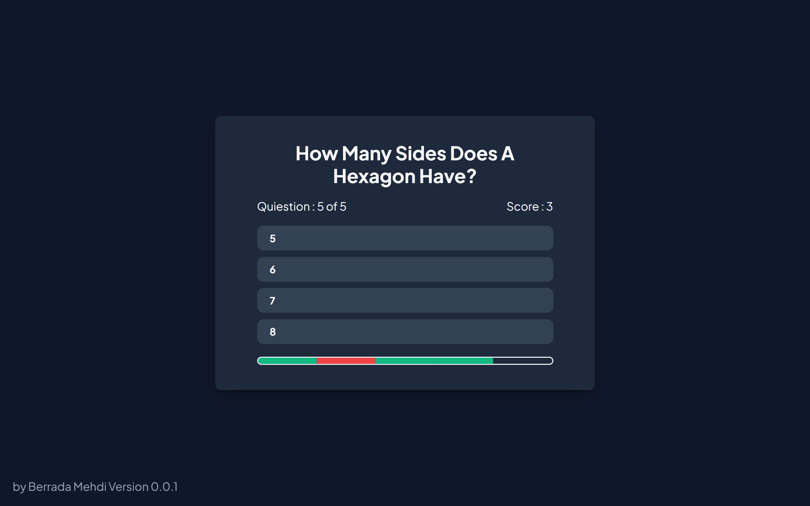

# Quiz Time 🎯

A sleek and modern interactive quiz web application built with HTML5, CSS3, and JavaScript, featuring a clean dark UI and dynamic state management.

---

## 📱 App Interface & New Update (v0.1.0)

<p align="center">
  
  
  
</p>

---

## ✨ Features & What's New in v0.1.0

- **Progress Tracker Bar:** Added a visual progress bar at the bottom of the question screen to track correct (green) and incorrect (red) answers dynamically across questions.
- **Interactive Quiz Flow:** Smooth transitions from the welcome screen to active questions and results.
- **Dynamic Score Tracking:** Real-time score updates as you answer questions.
- **Restart Capability:** Option to restart the quiz and try again instantly.
- **Modern Dark UI:** Clean, minimalist dark theme with ergonomic styling.

---

## 🛠️ Tech Stack

- **Markup:** HTML5
- **Styling:** CSS3 (Flexbox, Custom Properties)
- **Logic:** Vanilla JavaScript (DOM Manipulation, State Handling)

---

## 🚀 Getting Started

### Prerequisites
A modern web browser (Google Chrome, Mozilla Firefox, Microsoft Edge, Safari).

### Installation
1. Clone the repository:
   ```bash
   git clone [https://github.com/your-username/Quiz-Time.git](https://github.com/your-username/Quiz-Time.git)